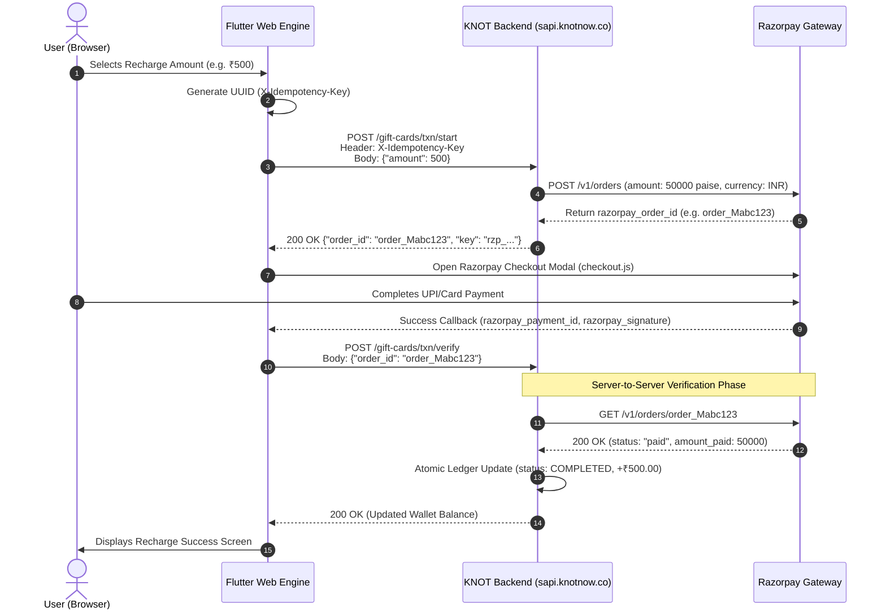

# KNOT – Payment Architecture & Lifecycle Specification

**Document Path**: `reports/full-assessment/payment-architecture.md`  
**System Evaluated**: KNOT Web (`knotnow.co`) & Backend API (`sapi.knotnow.co`)  
**Auditor**: Senior Backend Security Engineer & Financial Systems QA Auditor  

---

## 1. System Overview & End-to-End Flow

The KNOT application utilizes a hybrid architecture featuring a Flutter Web compiled client, a Server-Driven UI (SDUI) component engine, an Azure Front Door CDN/WAF edge layer, and a RESTful backend API (`sapi.knotnow.co`).

Payments and financial transactions are divided into two distinct subsystems:
1. **Ecommerce Order Checkout**: Goods purchase supporting Cash on Delivery (COD) and Online Payment via Razorpay (`checkout.razorpay.com`).
2. **Gift Card & Wallet Recharges**: Digital stored-value balance purchases processed through Razorpay and recorded in a customer wallet ledger.

---

## 2. Sequence Diagram: Wallet Recharge Lifecycle



---

## 3. Detailed Component Breakdown

### 3.1 Transaction Initiation (`POST /gift-cards/txn/start`)
- **Client Implementation**: Function `bfT(a)` in [main.dart.js](file:///Users/aryan/KNOT-Security/reports/flutter/main.dart.js):
  ```javascript
  n = B.bf.hX(); // Generates UUID v4
  j = t.z;
  return A.k(
    $.eR().b26(
      "/gift-cards/txn/start",
      a,
      A.ank(null, null, null, A.a(["X-Idempotency-Key", n], t.N, j)),
      j
    ),
    $async$Ad
  );
  ```
- **Security Control**:
  - `X-Idempotency-Key`: Transmitted with each initiation call. Prevents the creation of duplicate pending gateway orders if network retries occur.
  - **Backend Responsibility**: The backend must bind `X-Idempotency-Key` and the authenticated `user_id` to the created internal transaction record with a unique database index.

---

### 3.2 Razorpay Checkout Gateway Integration
- **SDK Loader**: Script tag dynamically inserted in [homepage.html](file:///Users/aryan/KNOT-Security/reports/homepage.html#L1410-L1415):
  ```html
  <script src="https://checkout.razorpay.com/v1/checkout.js" async defer></script>
  ```
- **Lifecycle Management**:
  - `window.razorpayRetry`: Retries script loading up to 3 times in case of transient CDN failure.
  - `window.flutterRazorpayLoadSuccessCallback`: Notifies Flutter when `typeof Razorpay !== "undefined"`.
  - Client handles three modal events:
    1. `payment.success`: User completed authentication with bank/UPI.
    2. `payment.error`: Payment declined, cancelled at bank, or timeout.
    3. `payment.external_wallet`: User chose an external wallet (Paytm/Mobikwik).

---

### 3.3 Post-Payment Verification (`POST /gift-cards/txn/verify`)
- **Client Implementation**: Function `cg3(a)` in [main.dart.js](file:///Users/aryan/KNOT-Security/reports/flutter/main.dart.js):
  ```javascript
  cg3(a) {
    return A.k(
      $.eR().a9V("/gift-cards/txn/verify", A.a(["order_id", a], t.N, t.S), t.z),
      $async$CE
    );
  }
  ```
- **Client Modal Cancellation**: Function `uV()` in [main.dart.js](file:///Users/aryan/KNOT-Security/reports/flutter/main.dart.js):
  ```javascript
  // Called when user dismisses or cancels payment modal:
  body: {"order_id": n.as, "is_cancelled": true}
  ```
- **Crucial Architectural Observation**:
  The client sends only `{"order_id": "<id>"}`. The client **does not transmit** `razorpay_payment_id` or `razorpay_signature` in this verification request.
  - Therefore, the security of the entire wallet balance system depends 100% on whether the backend queries Razorpay's API server-to-server or processes webhooks.

---

### 3.4 Webhook Architecture (`/webhooks/razorpay`)
Razorpay provides asynchronous webhook events:
- `order.paid`: Sent when an order is completely paid.
- `payment.captured`: Sent when funds are captured.
- `payment.failed`: Sent when a payment fails.
- `refund.processed`: Sent when a refund is completed.

**Security Architecture Standard**:
Every webhook must be validated using Razorpay's HMAC SHA256 signature algorithm:
$$\text{X-Razorpay-Signature} \equiv \text{HMAC-SHA256}(\text{Raw-Body}, \text{Webhook-Secret})$$

---

### 3.5 Legacy PayU Integration Analysis
- The codebase contains legacy PayU class references inherited from third-party payment aggregation libraries.
- Static scanning reveals no active PayU API routing in current production checkout workflows (`sapi.knotnow.co` actively communicates only with Razorpay). PayU components are dormant.
